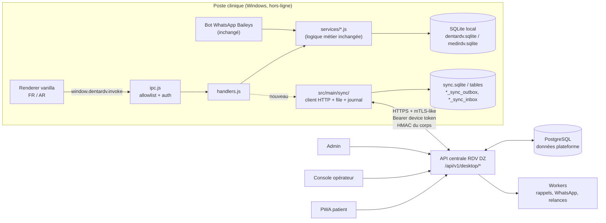
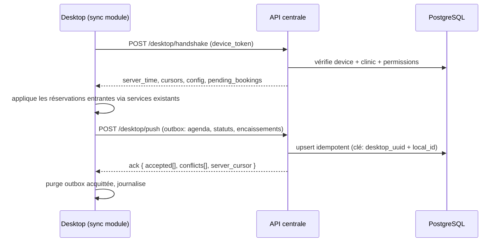

# Phase 1 — Audit des projets existants (DENTARDV / MEDIRDV)

> Statut : **terminé**, réalisé à partir du code source réel présent dans le dépôt
> (`dentardv/`, `medirdv/`), des tests exécutés localement, et de la lecture
> exhaustive des services, schémas SQLite et couches IPC.
>
> Aucun fichier de `dentardv/` ni de `medirdv/` n'a été modifié pendant l'audit.
> Aucune base de production n'a été ouverte.

---

## 1. Résumé exécutif

| | DENTARDV | MEDIRDV |
|---|---|---|
| Version | 1.2.0 | 1.0.0 |
| Domaine | Cabinet dentaire | Cabinet médical / polyclinique |
| Plateforme | Electron 38 (Windows 10/11) | Electron 38 (Windows 10/11) |
| Base locale | SQLite via `better-sqlite3` 13 | SQLite via `better-sqlite3` 13 |
| Fichier de données | `%APPDATA%\DentaRDV\data\dentardv.sqlite` | `%APPDATA%\MediRDV\data\medirdv.sqlite` |
| Version de schéma | `PRAGMA user_version = 2` | `PRAGMA user_version = 1` |
| UI | HTML/CSS/JS *vanilla*, sans build | HTML/CSS/JS *vanilla*, sans build |
| Langues | FR + AR (RTL), changement à chaud | FR + AR (RTL), changement à chaud |
| WhatsApp | Baileys 7 (QR, messages entrants) | Baileys 7 (QR, messages entrants) |
| Authentification | 1 mot de passe local (scrypt, verrou 30 min) | idem |
| Réseau | **aucune** requête sortante hors WhatsApp | idem |
| Tests locaux exécutés | **100 / 100 ✅** | **103 / 103 ✅** |
| Nombre de fichiers source (hors tests) | 91 | 86 |

**Conclusion de l'audit :** les deux applications sont matures, cohérentes,
offline-first, et **ne partagent pas le même schéma** (MediRDV ajoute
`departments`, `prescriptions`, `medication`, `medical_certificates` ; DENTARDV
ajoute une file d'attente par capacité journalière globale). Elles ont en
revanche **exactement la même architecture interne** (services purs +
`handlers.js` sans Electron + IPC générique + serveur de démonstration HTTP),
ce qui permet une stratégie d'intégration **identique et non invasive** : un
module de synchronisation branché sur la couche `handlers`, jamais sur la base.

---

## 2. DENTARDV — audit détaillé

### 2.1 Pile technique et dépendances

| Dépendance | Version | Rôle | Risque pour l'intégration |
|---|---|---|---|
| `electron` | ^38.8.6 | runtime bureau | aucun |
| `better-sqlite3` | ^13.0.3 | connexion SQLite synchrone unique | **module natif** : doit être compilé pour la version d'Electron (`npm run rebuild`) |
| `@whiskeysockets/baileys` | 7.0.0-rc14 | WhatsApp non officiel (QR) | non conforme au modèle « WhatsApp Business Platform » demandé → voir §6 |
| `pino` | ^10.4.0 | logs | aucun |
| `qrcode` | ^1.5.4 | QR d'appairage | aucun |
| `electron-builder` | ^26.15.3 | installateur NSIS / portable | aucun |
| `jsdom` (dev) | ^30.1.3 | tests du renderer | aucun |

Aucune dépendance réseau (pas d'`axios`, pas de client HTTP). L'application
n'effectue **aucun appel sortant** hors WhatsApp : c'est un atout majeur pour
l'introduction de la synchronisation (surface d'attaque réseau actuellement
nulle).

### 2.2 Architecture interne (identique dans les deux produits)

```
src/main/index.js            boot Electron, fenêtre, planificateur de rappels
  ├── db/index.js            ouverture SQLite + WAL + migrations + sauvegardes
  │     └── db/schema.js     MIGRATIONS[] + PRAGMA user_version
  ├── services/*.js          logique métier PURE (aucun import Electron)
  ├── handlers.js            table d'actions 'domaine:action' (PURE)
  ├── ipc.js                 ipcMain.handle('dentardv:invoke', method, payload)
  ├── preload/index.js       contextBridge → window.dentardv.invoke()
  └── renderer/…             UI sans build (i18n.js, api.js, ui.js, pages/)
demo/server.js               même handlers + même renderer en HTTP (/api/invoke)
```

Points clés relevés dans le code :

- `handlers.js` **n'importe pas Electron** : dialogues, impression et service
  WhatsApp sont injectés (`createHandlers(context)`). C'est le point d'ancrage
  idéal pour la synchronisation.
- `PUBLIC` (dans `handlers.js`) liste les seules actions accessibles sans mot de
  passe (`app:bootstrap`, `auth:*`, `app:info`, `app:demo`).
- `ipc.js` applique `auth.requireUnlocked()` à toute action hors `PUBLIC`.
- `createWindow()` impose `contextIsolation: true`, `sandbox: true`,
  `nodeIntegration: false`, navigation externe bloquée, `CSP` stricte dans
  `index.html` (`default-src 'self'`, `connect-src 'self'`).
- `app.requestSingleInstanceLock()` : une seule instance, sinon duplication des
  numéros de passage de la file.
- Sauvegardes : `VACUUM INTO` (snapshot cohérent), `integrity_check`, rotation.
- Mode démo séparé (`demo.mode`, `%APPDATA%\DentaRDV-Demo`) et mot de passe
  `1234` **uniquement** en mode démo.

### 2.3 Modèle de données effectif (schéma v2)

| Table | Colonnes principales | Remarques pour l'intégration |
|---|---|---|
| `settings` | `key`, `value` (TEXT) | 27 clés validées (`services/settings.js`) ; **extension sans migration** → c'est là que vivront les secrets de synchronisation |
| `patients` | `id` INTEGER, `full_name`, `phone`, `phone_norm` (9 derniers chiffres, UNIQUE partiel), `birth_date`, `gender`, `notes` | identifiant **local entier**, pas d'UUID → une table de correspondance est indispensable |
| `treatments` | `name_fr`, `name_ar`, `default_price`, `color`, `active` | catalogue d'actes avec prix en DZD |
| `appointments` | `id`, `patient_id`, `day` (`YYYY-MM-DD`), `queue_number`, `status ∈ {booked,done,cancelled,no_show}`, `source ∈ {manual,whatsapp,waiting}`, `treatment_id`, `treatment_name`, `price`, `notes` | **pas d'heure de rendez-vous** : le modèle est un *numéro de passage* dans une journée, avec `daily_capacity` global et `avg_session_minutes` pour l'ETA |
| index unique | `(day, queue_number) WHERE status <> 'cancelled'` | garantit l'unicité du créneau côté client (protection de concurrence locale) |
| `payments` | `patient_id`, `appointment_id`, `amount`, `method ∈ {cash,card,transfer}`, `paid_at` | **append-only**, dettes = somme des paiements |
| `expenses`, `expense_categories` | — | comptabilité de charge |
| `waiting_list` | `full_name`, `phone`, `note`, `handled` | liste d'attente quand la journée est pleine |
| `reminders` | `appointment_id` PK | anti-double rappel |
| `bot_messages` | `phone`, `direction`, `body` | journal du bot |
| `chat_events` (v2) | `kind ∈ {booked,cancelled,turn_now,queue_ahead,incoming}`, `delivery ∈ {local,queued,sent,failed}` | flux « Mini Chat » temps réel |

**Ce qui n'existe pas** (et devra être apporté par la plateforme centrale) :
heures de rendez-vous précises, verrou de créneau pendant un paiement,
statuts `PENDING / AWAITING_PAYMENT / PAID / CONFIRMED / REJECTED / COMPLETED /
NO_SHOW / REFUNDED`, téléconsultation, rôles/multi-utilisateurs, commissions,
traçabilité des changements de statut.

### 2.4 Règles métier existantes (à préserver)

- Une journée n'est réservable que si son jour de semaine ∈ `working_days`
  (défaut `0,1,2,3,4` = dimanche→jeudi).
- Capacité journalière `daily_capacity` (1..100, défaut 10) ; les rendez-vous
  `cancelled`/`no_show` ne consomment pas de place.
- `queue_number` = premier numéro libre ≤ capacité.
- Horizon de réservation `booking_horizon_days` (défaut 45).
- Réservation WhatsApp : premier jour libre **à partir de demain** ;
  `allow_same_day_booking` contrôle le sélecteur du secrétariat.
- `price` d'un rendez-vous ne peut jamais descendre sous le montant déjà
  encaissé (`PRICE_BELOW_PAID`).
- Toute action sensible exige un déverrouillage (session 30 min glissante,
  verrouillage après 5 échecs pendant 60 s).

### 2.5 API interne existante (surface IPC) — DENTARDV

58 actions. Les plus importantes pour la synchronisation :

```
app:bootstrap, app:info, auth:{status,setup,login,lock,change-password}
settings:{get,set,day-labels}
dashboard:today
patients:{list,get,create,update,remove,debtors}
appointments:{agenda,day-info,next-free-day,range,create,update,reschedule,
              status,cancel,complete,waiting-list,waiting-handle}
treatments:{list,create,update,remove}
payments:{add,pay-debt,by-day,by-patient,remove,receipt}
expenses:*, reports:{daily,monthly}
backup:{list,create,restore,restore-dialog,export,reveal}
export:{sheet,clipboard,reveal}, print:{receipt,daily-report}
wa:{status,start,stop,logout,preview,reminders-now}
```

Signatures utiles :
`appointments.create({patient_id, day?, treatment_id?, price?, notes?, source?, historical?})`,
`appointments.cancel({id})`, `appointments.reschedule({…})`,
`patients.upsertFromWhatsApp({name, phone})`, `payments.add({patient_id, appointment_id, amount, method})`.
`AppError` transporte un `code` traduit par le renderer : ce contrat d'erreur
doit être conservé tel quel.

### 2.6 Tests existants (DENTARDV) — 100 tests, 20 fichiers

`appointment-edit`, `auth-backup`, `booking`, `bot`, `dates`, `demo-build`,
`demo-seed`, `design`, `electron-main`, `export-sheets`, `i18n`, `log`,
`mini-chat-queue`, `packaging`, `payments-reports`, `renderer.smoke`,
`whatsapp-guard`, `whatsapp-transport`.

Exécution locale : **100/100 ✅** (`npm test`, ~38 s).
Note d'environnement : sur cette machine (réseau restreint à npm/GitHub),
`better-sqlite3` a dû être compilé avec `--nodedir=/usr/local` et `electron`
n'a pas pu être téléchargé (`ELECTRON_SKIP_BINARY_DOWNLOAD` non défini) ;
les tests n'en ont pas besoin. Sur un poste de développement normal,
`npm install` suffit.

---

## 3. MEDIRDV — audit détaillé

Même pile, mêmes dépendances, **même architecture** ; les différences sont
fonctionnelles et documentées ci-dessous.

### 3.1 Schéma (v1) — différences avec DENTARDV

| Table | Rôle | Impact sur l'intégration |
|---|---|---|
| `departments` | services/départements : `name_fr`, `name_ar`, `specialty`, `doctor_name`, `consultation_fee`, `daily_capacity`, `avg_session_minutes`, `working_days`, `room`, `instructions`, `active` | **multi-spécialités** : chaque département a sa propre capacité, ses jours ouvrés, ses honoraires et son médecin |
| `treatments` | actes, avec `department_id` | prix par acte **et** par département |
| `appointments` | + `department_id`, `department_name`, `vitals` | file d'attente **par département** : index unique `(day, COALESCE(department_id,0), queue_number) WHERE status <> 'cancelled'` |
| `waiting_list` | + `department_id`, `department_name` | — |
| `chat_events` | + `department_id`, `department_name` | — |
| `patients` | + `blood_group`, `allergies`, `chronic_conditions` | **données de santé sensibles** (art. 18 loi 18-07) → ne jamais les remonter à la plateforme |
| `medications` | catalogue Nomenclature algérienne (`brand`, `dci`, `strength`, `form`, `specialty`, `keywords_ar`) | local uniquement |
| `prescriptions` + `prescription_items` | ordonnances, constantes, bilans | local uniquement, impression A4 |
| `prescription_templates` | protocoles réutilisables | local uniquement |
| `medical_certificates` | arrêts de travail / aptitude / scolaire | local uniquement |

`settings` MEDIRDV : + `clinic_wilaya`, `doctor_name`, `doctor_specialty`,
`doctor_ordre` (n° du Conseil de l'Ordre) — **champs directement réutilisables
pour le profil public du médecin**.

### 3.2 Surface IPC — différences

MEDIRDV = DENTARDV **plus** :

```
departments:{list,get,create,update,remove}
prescriptions:{…}, prescription-templates:{…}, certificates:{…}
medications:{…}   (catalogue Nomenclature)
dashboard:today(day, departmentId)
appointments:*     (paramètre department_id)
print:prescription, print:certificate
```

`dashboardToday(day, departmentId)`, `appointments.dayStats(day, departmentId)`
et `appointments.agenda(day, departmentId)` sont les équivalents multi-services.

### 3.3 Tests existants (MEDIRDV) — 103 tests, 21 fichiers

Idem DENTARDV + `medical-clinic.test.js` (départements, prescriptions,
certificats). Exécution locale : **103/103 ✅** (~37 s).

---

## 4. Ce qui manque dans les deux applications (écarts par rapport au brief)

| Exigence du brief | État actuel | Décision |
|---|---|---|
| Heures de rendez-vous précises (slots) | absent (numéro de passage/jour) | **conservé côté desktop**, ajouté côté plateforme ; la synchronisation expose une *plage horaire* calculée (`avg_session_minutes`) |
| Anti-double réservation **entre** plusieurs clients | uniquement locale (index partiel) | verrou serveur PostgreSQL (`SELECT … FOR UPDATE` + contrainte d'exclusion) |
| Statuts enrichis (PAID, CONFIRMED, PENDING…) | 4 statuts | mapping explicite (voir `01-ARCHITECTURE.md` §7) |
| Paiement en ligne + commissions | caisse locale uniquement | plateforme centrale ; le desktop reste la caisse de la clinique |
| Téléconsultation | absent | plateforme centrale + réception dans le desktop |
| Rôles / multi-utilisateurs | 1 mot de passe par clinique | plateforme centrale (RBAC) ; desktop inchangé |
| WhatsApp **Business Platform** (officiel) | Baileys (non officiel) | **ne pas toucher** au bot existant ; la plateforme utilise l'API officielle + repli clic-pour-discuter |
| Journal d'audit, RGPD/18-07 | sauvegardes + logs techniques | plateforme centrale |
| Synchronisation serveur | inexistante | **module `sync/` ajouté** (voir §5) |

---

## 5. Stratégie d'intégration retenue (non destructive)

### 5.1 Principes

1. **La base SQLite reste la propriété exclusive du poste.** La plateforme ne
   se connecte **jamais** directement au fichier SQLite, ne le lit pas, ne
   l'écrase pas. Aucune migration destructive.
2. **Le point d'ancrage est `handlers.js`.** Un nouveau dossier
   `src/main/sync/` est ajouté et enregistre ~6 actions `sync:*` dans
   `handlers.js`. Aucune ligne existante n'est réécrite ; au pire, un
   `require` et une entrée de table.
3. **Un identifiant stable (`uuid`) est ajouté aux tables concernées par
   migration additive** (`ALTER TABLE … ADD COLUMN`, `CREATE TABLE … IF NOT
   EXISTS`), avec bump de `SCHEMA_VERSION`. Les colonnes existantes ne changent
   pas, les index existants restent valides, l'application continue de
   fonctionner sans le module (mode `sync désactivé` par défaut).
4. **Offline-first par conception** : toute réservation reçue de la plateforme
   est d'abord écrite localement dans une *file d'entrée* puis appliquée via
   les **services existants** (`appointments.create`, `patients.create`,
   `payments.add`). Si le poste est éteint, la plateforme garde la réservation
   et la rejoue : la file d'entrée est idempotente.
5. **Conflit** : le desktop est **maître** de son agenda (il connaît le
   patient physiquement présent). Une réservation distante qui entre en
   collision avec une réservation locale est renvoyée à la plateforme en
   `SYNC_CONFLICT` et n'écrase jamais rien.
6. **Aucune donnée de santé ne remonte** : seuls identité, contact,
   rendez-vous, prix et statut de paiement transitent. `allergies`,
   `chronic_conditions`, `prescriptions`, `medical_certificates` restent sur le
   poste (minimisation, art. 16 loi 18-07).

### 5.2 Diagramme d'intégration



### 5.3 Séquence de synchronisation (pull / push)



---

## 6. Constats de conformité (à traiter au niveau plateforme)

1. **WhatsApp** : le bot Baileys des deux applications est un automatisme non
   officiel. Le brief interdit ce type d'automatisation **pour la plateforme**.
   Décision : (a) le bot existant n'est **pas** supprimé (fonctionnalité
   acquise, utilisée en local) ; (b) la plateforme n'utilise que l'API
   WhatsApp Business officielle, avec **repli clic-pour-discuter**
   (`https://wa.me/<num>?text=…`), sans automatisation (voir
   `06-SECURITY-COMPLIANCE.md` §5).
2. **Loi 18-07 modifiée par la loi 25-11 du 24 juillet 2025** : déclaration
   préalable à l'ANPDP, autorisation préalable pour tout transfert hors
   d'Algérie, analyse d'impact, registre des traitements, notification des
   violations, DPO. Conséquence d'architecture : **les données de santé ne
   doivent pas partir hors d'Algérie** ; l'hébergement cible doit être local ou
   l'export désactivé (voir `05-COST.md` §4 et `06-SECURITY-COMPLIANCE.md`).
3. **Télémédecine** : reconnue comme acte médical (loi 18-11), mais
   l'exploitation commerciale (paiement en ligne d'actes cliniques) exige une
   revue juridique. Décision : module construit, **drapeau
   `telemedicine.paid_enabled = false` par défaut**, messages d'information et
   blocage explicite tant que la revue n'est pas signée.

---

## 7. Risques identifiés et parades

| Risque | Probabilité | Impact | Parade retenue |
|---|---|---|---|
| Duplication de numéros de passage si la plateforme écrit directement en base | moyenne | élevé | jamais d'écriture directe : passage par `appointments.create` (transaction + index unique) |
| Deux instances du desktop | faible | moyen | `requestSingleInstanceLock()` déjà en place ; le module sync refuse de démarrer si un verrou de synchronisation existe |
| Perte de réservations si le poste est éteint | élevée | élevé | la plateforme est la source de vérité des réservations **en ligne** ; file d'entrée rejouable + curseurs |
| Fuite de données médicales | faible | critique | minimisation (allowlist de champs), chiffrement en transit, liens signés pour les pièces jointes, séparation des tables |
| Verrou natif `better-sqlite3` désynchronisé de la version Electron | moyenne | moyen | `npm run rebuild` documenté ; aucune nouvelle dépendance native ajoutée par le module sync (HTTP via `node:https`) |
| Panne réseau / API indisponible | élevée | faible | le desktop reste 100 % fonctionnel hors-ligne (comportement actuel) |
| Non-conformité paiement (SIM) | moyenne | élevé | adaptateur sandbox **explicitement étiqueté**, aucun statut « payé » sans webhook signé |

---

## 8. Recommandations

1. Ne **jamais** faire évoluer les schémas SQLite autrement que par migrations
   additives et versionnées (`user_version`), avec sauvegarde automatique
   avant migration.
2. Livrer le module de synchronisation **désactivé par défaut** ; l'activation
   se fait par le médecin (écran Paramètres → « RDV DZ »).
3. Considérer la plateforme comme la **source de vérité des réservations en
   ligne** et le desktop comme la **source de vérité de l'agenda physique** ;
   toute divergence est journalisée, jamais résolue silencieusement.
4. Conserver `AppError.code` comme contrat stable (i18n + tests).
5. Avant toute mise en production : revue juridique 18-07/25-11, convention
   avec un prestataire de paiement agréé, revue du cadre télémédecine.
