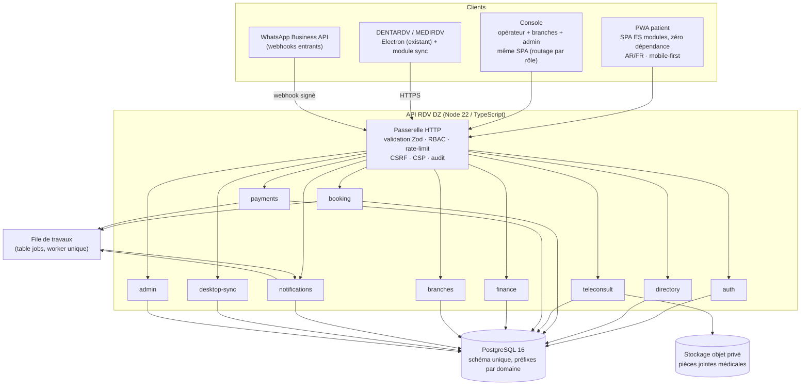
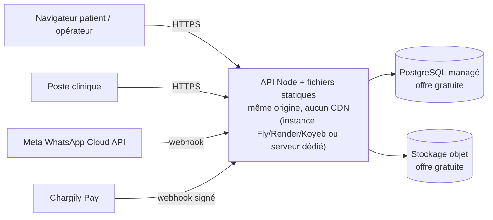
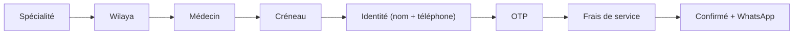

# Phase 1 — Architecture proposée & feuille de route

## 1. Vue d'ensemble du produit

Un **monolithe modulaire** TypeScript (une API, des modules à frontières
explicites) plutôt que des microservices. Raison : équipe réduite, coût
d'exploitation minimal, transactions distribuées inutiles. Chaque module
respecte une frontière vérifiée par un test de contrat (imports autorisés).

### Découpage logique (modules)

| Module | Responsabilité | Ne connaît pas |
|---|---|---|
| `auth` | inscription, OTP téléphone, sessions, rôles, MFA | agenda, argent |
| `directory` | wilayas/communes, spécialités, cliniques, médecins, recherche, avis modérés | paiement |
| `booking` | créneaux, verrou, statuts, historique, annulation/refus | mode de paiement concret |
| `teleconsult` | demandes, messages, pièces jointes, réponses, clôture | transport de paiement |
| `payments` | **adaptateurs** PSP, intentions, callbacks signés, idempotence, remboursements | règles d'agenda |
| `finance` | règles de commission, grands livres, reversements, rapports | PSP |
| `branches` | branches, managers, opérateurs, périmètres | clinique détail |
| `notifications` | modèles AR/FR, canaux (in-app, e-mail, WhatsApp, SMS), préférences | contenu médical |
| `desktop-sync` | appairage d'appareil, push/pull, conflits, journal de synchronisation | UI desktop |
| `admin` | vérification, suspension, modération, paramètres, audit | — |

Règle de dépendance : `booking` et `teleconsult` **ne dépendent jamais** d'un
PSP concret ; ils dépendent de l'interface `PaymentProvider`. `finance` ne
dépend que de la base. Aucun module n'importe `admin` (sens unique).

## 2. Pile technique et justifications

| Couche | Choix | Justification / coût |
|---|---|---|
| API | Node.js 22, **Fastify 5**, TypeScript strict | rapide sur les plus petites instances gratuites, validation JSON Schema intégrée |
| Validation | JSON Schema (Fastify) + garde-fous métier explicites | zéro dépendance de runtime supplémentaire |
| Base | **PostgreSQL** (prod) via `pg` ; **PGlite/WASM** en dev et tests | même dialecte SQL (index partiels, `FOR UPDATE`, `gen_random_uuid()`), tests sans serveur |
| Migrations | SQL numérotées + table `schema_migrations`, exécuteur maison | lisible, rejouable, aucun ORM imposé |
| Front | **SPA sans dépendance** : modules ES natifs + CSS maison, PWA (manifest + service worker), servie par l'API elle-même | aucun build, aucun `node_modules` côté navigateur, une seule origine (donc zéro CORS, `'self'` en CSP stricte, déploiement = le serveur Node) |
| Paiements | adaptateur `choragily` (API v2 réelle, Chargily Pay), `manual` (espèces/virement constaté), `sandbox` (**simulé, étiqueté**) | voir `04-PAYMENTS.md` |
| WhatsApp | API WhatsApp Business Cloud (officielle) + repli `wa.me` | aucune automatisation non officielle |
| Téléconsultation vidéo | WebRTC pair-à-pair, salle signée côté serveur | pas de coût de fournisseur ; enregistrement désactivé |
| Jobs | table `jobs` + worker `FOR UPDATE SKIP LOCKED` | pas de Redis en MVP |
| Logs / audit | `audit_logs` + journal applicatif JSON | exigence 18-07 (registre) |
| Tests | `node:test` + `pg` sur PGlite | aucune infrastructure CI payante |

## 3. Modèle de sécurité (résumé — détail en `06`)

- Sessions serveur (cookie `HttpOnly; Secure; SameSite=Lax`) + jeton CSRF
  double-soumission pour les mutations ; **aucun jeton en `localStorage`**.
- Mots de passe : `scrypt` (N=16384) — même primitive que les applications
  desktop, donc même niveau de rigueur, sans dépendance native.
- OTP SMS : code à 6 chiffres, 5 minutes, 5 tentatives, anti-rejeu.
- RBAC + **périmètre** (wilaya / branche / médecins assignés) appliqué dans la
  couche SQL, pas seulement dans le handler.
- Desktop : `device_token` (32 octets, haché en base) + **HMAC du corps** par
  requête + horodatage anti-rejeu (±300 s) + révocation par appareil.
- Pièces jointes : stockage privé, jamais servies en direct, lien signé
  HMAC valable 5 minutes, `Content-Disposition: attachment`.
- Journal d'audit inaltérable (append-only, pas d'UPDATE/DELETE applicatif).

## 4. Diagramme de déploiement (cible gratuite)

⚠️ **Transfert hors Algérie** : la plupart des offres gratuites hébergent en
Europe/USA. La loi 18-07 (mod. 25-11) soumet tout transfert à autorisation
préalable de l'ANPDP. Tant que cette autorisation n'est pas obtenue, le
déploiement de production doit rester **on-premise / datacenter algérien**, et
les pièces jointes médicales ne doivent pas quitter le pays. Les offres
gratuites ne servent qu'au développement et aux démonstrations avec **données
fictives**. Voir `05-COST.md` §4.

## 5. Contrats d'API (style)

- Base : `/api/v1`. Le front est servi par le **même processus** (`src/routes/web.js`) :
  `/` renvoie `src/web/index.html`, les assets sont statiques, `/api/*` reste l'API.
  Aucun CORS, aucun proxy tiers, aucune police ou script distant.
- Front : SPA en modules ES natifs (`src/web/`), routage par hash, aucune étape
  de build ; CSP `default-src 'self'` avec styles inline uniquement.
- Erreurs : `{ "error": { "code": "SLOT_TAKEN", "message": "…", "details": {} } }`,
  HTTP 4xx/5xx cohérents. Codes stables et traduits côté UI (AR/FR).
- Pagination : `?limit=20&cursor=<opaque>` → `{ items, next_cursor }`.
- Idempotence : en-tête `Idempotency-Key` obligatoire sur
  `POST /payments/:id/confirm` et `POST /bookings`.
- Toute mutation sensible écrit une ligne `audit_logs`.
- Spécification complète : `03-API.md`.

## 6. Parcours patient (le plus court possible)

Objectif mesuré par un test : **≤ 8 interactions** pour un rendez-vous
payant, **4** pour un rendez-vous gratuit (frais = 0).

## 7. Correspondance des statuts (desktop ↔ plateforme)

| Plateforme | DENTARDV / MEDIRDV | Sens |
|---|---|---|
| `PENDING` | *(aucun)* | réservation créée, confirmation manuelle du médecin requise |
| `AWAITING_PAYMENT` | *(aucun)* | créneau tenu, en attente du PSP |
| `PAID` | *(aucun)* | payé, en attente de confirmation |
| `CONFIRMED` | `booked` | poussé dans l'agenda local |
| `CANCELLED` | `cancelled` | libère le créneau |
| `REJECTED` | `cancelled` (+ motif) | refus explicite du médecin |
| `COMPLETED` | `done` | séance réalisée |
| `NO_SHOW` | `no_show` | patient absent |
| `REFUNDED` | `cancelled` + note | remboursement tracé dans `finance` |

Le desktop ne connaît **pas** les états financiers de la plateforme : il ne
les stocke pas et ne les affiche pas comme une recette de la clinique. Le
« service fee » est une recette de **la plateforme**, jamais du cabinet.

## 8. Feuille de route

| Phase | Contenu | Critère de sortie (testé) | État |
|---|---|---|---|
| 1 | Audit, architecture, schéma, contrat d'API, coûts | documents relus, incohérences levées | **fait** |
| 2 | Socle API : migrations, auth, RBAC, patients, médecins, cliniques | inscription + OTP + login + 403 par rôle | **fait** |
| 3 | Annuaire + réservation + verrou anti-double + historique de statuts | 2 réservations concurrentes → 1 seule acceptée | **fait** |
| 4 | Console opérateur / branches / admin | un opérateur ne voit pas une autre branche | **fait** |
| 5 | Synchronisation desktop non destructive | outbox/inbox, conflits, rejeu idempotent | **fait** (module + tests) |
| 6 | Téléconsultation + pièces jointes signées | accès refusé hors cercle soignant | **fait** |
| 7 | Paiements (adaptateur Chargily + sandbox + webhook signé) + commissions | faux webhook rejeté, double webhook idempotent | **fait** |
| 8 | Rapports, exports, notifications, préférences | totaux exacts, encaissements en attente exclus | **fait** |
| 9 | Durcissement, tests complets, déploiement, documentation AR/FR | `npm test` vert, aucun secret dans le front | **fait** |

Les éléments **bloqués par une dépendance externe** (identifiants Chargily
live, numéro WhatsApp Business vérifié, autorisation ANPDP, convention
télémédecine) sont livrés sous forme d'adaptateur complet, désactivé, avec un
état explicite dans `docs/STATUS.md`.
