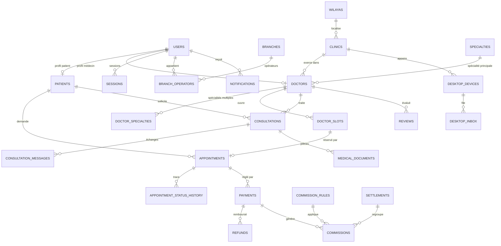

# Phase 1 — Conception de la base de données

Cible : **PostgreSQL ≥ 14** (production) et **PGlite** (développement/tests —
même dialecte, aucun serveur requis). Toutes les migrations sont des fichiers
SQL numérotés, rejouables, appliqués une seule fois via `schema_migrations`.

## 1. Principes

1. **UUID v4** (`gen_random_uuid()`) pour toutes les clés primaires exposées.
2. **Trois domaines séparés** par des préfixes et des droits distincts :
   - *opérationnel & identité* : `users`, `patients`, `appointments`, `payments`…
   - *médical* : `medical_documents`, `consultation_messages` (contenu clinique),
   - *finance* : `payments`, `refunds`, `commissions`, `settlements` (écriture
     append-only pour les grands livres).
3. **Argent en entiers** : montants stockés en `integer` (centimes de DZD) —
   jamais de `float`. Taux de commission en `numeric(5,2)` (pourcentage).
4. **Aucune suppression destructive** des données médicales (`deleted_at`
   logique), suppression physique réservée aux tables de travail.
5. **Horodatage** : `timestamptz` partout, `created_at default now()`.
6. **Contraintes nommées** (`ck_`, `uq_`, `fk_`, `ix_`) pour des erreurs
   exploitables et des tests stables.

## 2. Diagramme entité-association (cœur)



## 3. Tables (description contractuelle)

### 3.1 Référentiels

| Table | Colonnes clés | Contraintes |
|---|---|---|
| `wilayas` | `code` PK (1..58), `name_ar`, `name_fr` | seedée |
| `specialties` | `code` PK (`DENT`, `CARDIO`…), `name_ar`, `name_fr`, `active` | seedée |
| `system_settings` | `key` PK, `value jsonb`, `updated_by`, `updated_at` | lecture publique limitée aux clés `public.*` |

### 3.2 Identité & accès

| Table | Colonnes | Contraintes / index |
|---|---|---|
| `users` | `id uuid`, `role`, `full_name`, `phone` (E.164 normalisé `+213…`), `email`, `password_hash`, `password_salt`, `status ∈ {ACTIVE,SUSPENDED,PENDING}`, `locale ∈ {ar,fr}`, `phone_verified_at`, `mfa_secret`, `failed_logins`, `locked_until`, `created_at` | `uq_users_phone` (partiel `where phone is not null`), `uq_users_email` idem, `ck_users_role` |
| `patients` | `user_id` (unique, nullable : un patient peut exister sans compte), `full_name`, `phone`, `birth_date`, `gender`, `wilaya_code`, `commune`, `consent_version`, `consent_at`, `created_at` | `fk_patients_user`, `fk_patients_wilaya` |
| `sessions` | `id`, `user_id`, `token_hash`, `csrf_token`, `ip`, `user_agent`, `created_at`, `expires_at`, `revoked_at` | `ix_sessions_token` (unique sur `token_hash`), `ix_sessions_user` |
| `otp_codes` | `id`, `phone`, `purpose ∈ {LOGIN,VERIFY,RESET}`, `code_hash`, `attempts`, `expires_at`, `consumed_at` | `ix_otp_phone_purpose` |
| `user_scopes` | `user_id`, `branch_id` (nullable), `wilaya_code` (nullable) | PK composite, `fk` cascade |
| `audit_logs` | `id`, `actor_user_id`, `actor_role`, `action`, `entity`, `entity_id`, `ip`, `user_agent`, `details jsonb`, `created_at` | **append-only** (aucun `update`/`delete` applicatif) |

Rôles : `SUPER_ADMIN`, `ADMIN`, `FINANCE_MANAGER`, `BRANCH_MANAGER`,
`OPERATOR`, `DOCTOR`, `PATIENT` (contrainte `CHECK`).

### 3.3 Annuaire

| Table | Colonnes | Notes |
|---|---|---|
| `clinics` | `id`, `name_ar`, `name_fr`, `kind ∈ {DENTAL,MEDICAL,POLYCLINIC}`, `wilaya_code`, `commune`, `address`, `phone`, `lat`, `lng`, `verified_at`, `verified_by`, `status`, `created_at` | recherche plein texte : index GIN sur `to_tsvector('simple', name_ar || ' ' || name_fr)` |
| `doctors` | `id`, `user_id`, `clinic_id`, `primary_specialty_code`, `license_no` (n° ordre), `bio_ar`, `bio_fr`, `consultation_fee`, `teleconsult_fee`, `teleconsult_enabled`, `verified_at`, `verified_by`, `accepting_new`, `rating_avg`, `rating_count` | `uq_doctors_license` (partiel), index `(wilaya via clinic)`, `(primary_specialty_code)` |
| `doctor_specialties` | `doctor_id`, `specialty_code` | PK composite |
| `clinic_hours` | `id`, `clinic_id`, `doctor_id` (nullable), `weekday 0..6`, `opens time`, `closes time`, `break_start`, `break_end` | `ck_hours_order` (`opens < closes`) |
| `doctor_time_off` | `id`, `doctor_id`, `starts_at`, `ends_at`, `reason` | bloque la génération de créneaux |

### 3.4 Réservation

| Table | Colonnes | Notes |
|---|---|---|
| `doctor_slots` | `id`, `doctor_id`, `starts_at timestamptz`, `ends_at`, `mode ∈ {IN_CLINIC,VIDEO,PHONE}`, `status ∈ {OPEN,HELD,BOOKED,BLOCKED}`, `hold_expires_at`, `created_at` | **`uq_slots_doctor_start_mode (doctor_id, starts_at, mode)`** ; index `ix_slots_search (doctor_id, starts_at) where status = 'OPEN'` |
| `appointments` | `id`, `reference` (ex. `RDV-2026-000123`), `slot_id` (unique), `patient_id`, `doctor_id`, `clinic_id`, `branch_id`, `created_by_user_id`, `source ∈ {PATIENT_WEBSITE,OPERATOR,BRANCH,WHATSAPP,OTHER}`, `status` (9 valeurs du brief), `mode`, `price`, `service_fee`, `currency`, `notes`, `cancel_reason`, `desktop_uuid`, `confirmed_at`, `completed_at`, `created_at`, `updated_at` | `uq_appointments_slot` (un créneau = un rendez-vous actif), `ck_appointments_status` |
| `appointment_status_history` | `id`, `appointment_id`, `from_status`, `to_status`, `actor_user_id`, `reason`, `created_at` | toute transition passe par `booking.changeStatus()` |
| `booking_holds` | `id`, `slot_id`, `patient_id`, `expires_at`, `payment_id`, `released_at` | un verrou expiré est libéré par le worker |

**Anti-double réservation** — trois barrières :
1. `doctor_slots` est la seule source de vérité des créneaux (aucun calcul
   implicite côté client) ;
2. la transition s'exécute dans une transaction avec
   `SELECT … FROM doctor_slots WHERE id = $1 FOR UPDATE` ;
3. `UNIQUE (slot_id)` sur `appointments` — la base refuse physiquement le
   second rendez-vous, même en cas de course applicative.

### 3.5 Téléconsultation (domaine médical)

| Table | Colonnes | Notes |
|---|---|---|
| `consultations` | `id`, `reference`, `patient_id`, `doctor_id`, `kind ∈ {ASYNC_TEXT,DOCUMENT_REVIEW,VIDEO_SCHEDULED,FOLLOW_UP}`, `status ∈ {REQUESTED,ACCEPTED,IN_PROGRESS,AWAITING_PATIENT,ANSWERED,CLOSED,REJECTED,CANCELLED}`, `price`, `commission_rate`, `symptom_summary` (texte libre du patient), `consent_at`, `emergency_ack_at`, `created_at`, `accepted_at`, `answered_at`, `closed_at`, `refusal_reason` | `ix_consult_doctor_status` |
| `consultation_messages` | `id`, `consultation_id`, `author_user_id`, `author_role`, `body`, `created_at`, `read_at` | accès restreint (patient, médecin, admin habilité) |
| `medical_documents` | `id`, `consultation_id`, `patient_id`, `doctor_id`, `storage_key`, `filename`, `mime`, `size_bytes`, `sha256`, `uploaded_by`, `created_at`, `deleted_at` | **jamais d'URL publique** ; téléchargement via lien signé 5 min ; types autorisés : pdf, jpg, png, webp, heic ; ≤ 10 Mo |
| `consultation_events` | `id`, `consultation_id`, `event`, `actor_user_id`, `details`, `created_at` | trace |

### 3.6 Paiements & finance

| Table | Colonnes | Notes |
|---|---|---|
| `payments` | `id`, `purpose ∈ {BOOKING_SERVICE_FEE,BOOKING_DEPOSIT,TELECONSULTATION}`, `appointment_id`, `consultation_id`, `patient_id`, `provider ∈ {chargily,manual,sandbox}`, `provider_ref`, `amount`, `currency`, `status ∈ {CREATED,PENDING,PAID,FAILED,REFUNDED,EXPIRED}`, `livemode`, `idempotency_key` (unique), `paid_at`, `created_at` | montants en centimes ; `livemode=false` ⇒ badge « SIMULATION » dans toute l'UI |
| `payment_events` | `id`, `provider`, `provider_event_id` (unique), `signature_valid`, `payload jsonb`, `received_at`, `processed_at` | journal de webhooks, rejouable |
| `refunds` | `id`, `payment_id`, `amount`, `reason`, `status ∈ {REQUESTED,APPROVED,PROCESSED,REJECTED}`, `provider_ref`, `requested_by`, `processed_at` | remboursement partiel interdit > montant payé |
| `commission_rules` | `id`, `scope ∈ {BOOKING_FEE,TELECONSULT}`, `platform_pct`, `branch_pct`, `operator_pct`, `psp_fixed`, `effective_from`, `active` | valeurs **configurables**, jamais codées en dur |
| `commissions` | `id`, `source_type`, `source_id`, `rule_id`, `beneficiary_type ∈ {PLATFORM,BRANCH,OPERATOR,DOCTOR,PSP}`, `beneficiary_id`, `amount`, `currency`, `status ∈ {ACCRUED,REVERSED,SETTLED}`, `created_at` | grand livre append-only |
| `settlements` | `id`, `beneficiary_type`, `beneficiary_id`, `period_start`, `period_end`, `gross`, `fees`, `net`, `status ∈ {DRAFT,APPROVED,PAID}`, `paid_at`, `reference` | reversements |

Règle comptable : une commission n'est **accrued** que si
`payments.status = 'PAID'` **et** `livemode = true`. Rien d'autre n'entre dans
le chiffre d'affaires.

### 3.7 Branches & opérateurs

| Table | Colonnes |
|---|---|
| `branches` | `id`, `code`, `name`, `wilaya_code`, `manager_user_id`, `commission_pct`, `status`, `created_at` |
| `branch_operators` | `branch_id`, `user_id`, `created_at` (PK composite) |
| `doctor_branches` | `doctor_id`, `branch_id`, `commission_pct` (PK composite) |
| `branch_performance` (vue) | volume, CA, commissions par branche/mois |

### 3.8 Synchronisation desktop

| Table | Colonnes | Notes |
|---|---|---|
| `desktop_devices` | `id`, `clinic_id`, `doctor_id`, `product ∈ {DENTARDV,MEDIRDV}`, `name`, `token_hash`, `secret`, `registered_at`, `last_seen_at`, `revoked_at` | 1 appareil = 1 poste ; révocation immédiate |
| `desktop_sync_log` | `id`, `device_id`, `direction ∈ {IN,OUT}`, `entity`, `local_id`, `remote_id`, `operation`, `status ∈ {ACK,CONFLICT,ERROR}`, `payload_hash`, `attempt`, `created_at` | journal lisible par le support |
| `desktop_inbox` | `id`, `device_id`, `kind ∈ {BOOKING,CANCELLATION,CONSULTATION,PAYMENT_NOTE}`, `payload jsonb`, `status ∈ {QUEUED,APPLIED,FAILED,EXPIRED}`, `attempts`, `available_at`, `applied_at`, `created_at` | rejouable, idempotent (`kind + payload->>'remote_id'` unique) |
| `desktop_conflicts` | `id`, `device_id`, `remote_id`, `local_id`, `reason`, `resolved_at`, `resolution` | résolution manuelle documentée |

### 3.9 Notifications, avis, travaux

| Table | Colonnes |
|---|---|
| `notification_templates` | `code`, `channel ∈ {IN_APP,EMAIL,WHATSAPP,SMS}`, `locale ∈ {ar,fr}`, `subject`, `body` (placeholders `{{…}}`), `whatsapp_template_name`, `active` — PK `(code, channel, locale)` |
| `notifications` | `id`, `user_id`, `channel`, `template_code`, `locale`, `payload jsonb`, `status ∈ {QUEUED,SENT,FAILED,READ}`, `dedupe_key` (unique), `read_at`, `created_at` |
| `notification_preferences` | `user_id`, `event_code`, `channel`, `enabled` (PK composite) |
| `reviews` | `id`, `doctor_id`, `patient_id`, `appointment_id` (unique), `rating 1..5`, `comment`, `status ∈ {PENDING,APPROVED,REJECTED}`, `moderated_by`, `created_at` |
| `jobs` | `id`, `kind`, `payload jsonb`, `run_at`, `attempts`, `max_attempts`, `status ∈ {PENDING,RUNNING,DONE,FAILED}`, `locked_at`, `last_error` |
| `wa_messages` | `id`, `to_phone`, `template_name`, `payload`, `mode ∈ {OFFICIAL_API,CLICK_TO_CHAT}`, `status`, `provider_message_id`, `created_at` |

## 4. Index et performances

- Recherche annuaire : `GIN (to_tsvector('simple', unaccent(name_ar || ' ' || name_fr)))`
  sur `clinics` et `doctors.bio_*` ; index B-tree `(wilaya_code)`,
  `(primary_specialty_code)`.
- Créneaux : index partiel `(doctor_id, starts_at) WHERE status = 'OPEN'` →
  la requête « prochains créneaux » reste sous la milliseconde.
- Rendez-vous : `(patient_id, created_at DESC)`, `(doctor_id, created_at DESC)`,
  `(status) WHERE status IN ('PENDING','AWAITING_PAYMENT','PAID')` pour les
  tableaux de bord.
- Paiements : `(status, created_at)` + unique `idempotency_key`.
- Journal d'audit : `(entity, entity_id, created_at DESC)` et `(actor_user_id)`.
- Aucune requête N+1 : les listes utilisent `JOIN` + agrégats.

## 5. Politique de conservation & sauvegarde

| Donnée | Durée | Base |
|---|---|---|
| Compte, rendez-vous, paiement | 10 ans (obligation comptable) | archivage froid après 3 ans |
| Documents médicaux | 20 ans (dossier médical) ou jusqu'au retrait du consentement, selon cadre légal | accès journalisé |
| Journaux d'audit | 5 ans minimum | append-only |
| OTP, sessions, jobs terminés | 30 jours | purge planifiée |
| Messages de consultation | 5 ans | suppression logique |

Sauvegardes : `pg_dump` chiffré quotidien + WAL archivé, **rétention 30 jours**,
restauration testée mensuellement (`scripts/restore-check.sh`). Les fichiers
médicaux ont leur propre cycle de sauvegarde (objet + checksum en base).

## 6. Migrations

```
rdvdz/platform/packages/db/migrations/
  001_reference_data.sql      wilayas, spécialités, réglages par défaut
  002_identity.sql            users, sessions, otp, scopes, audit
  003_directory.sql           cliniques, médecins, horaires, congés
  004_booking.sql             créneaux, rendez-vous, historique, verrous
  005_teleconsult.sql         consultations, messages, documents médicaux
  006_payments_finance.sql    paiements, événements, remboursements, commissions, reversements
  007_branches.sql            branches, opérateurs, affectations
  008_desktop_sync.sql        appareils, journal, boîte de réception, conflits
  009_notifications_reviews.sql modèles, notifications, préférences, avis, jobs
  010_views.sql               vues de reporting (aucune donnée dupliquée)
```

Chaque fichier est **idempotent** (`IF NOT EXISTS`) et **additif**. Aucune
migration ne supprime une colonne. Un `CHECK` sur `schema_migrations` empêche
de rejouer une version déjà appliquée.
